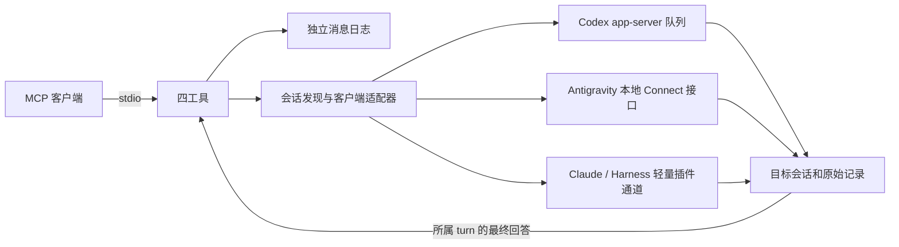

# Agent HUD 互发子系统拆解

事实源固定为 [jazzenchen/agent-hud-open](https://github.com/jazzenchen/agent-hud-open/tree/d14bc43fe117f2f5d4e9143d5ebcf92c62225a66)，Apache-2.0。服务重新实现无头宿主；插件和协议规则保留来源声明。

| 上游代码 | 职责 | 本工程处理 |
| --- | --- | --- |
| `src/apps/mcp/src/host-tools.ts` | MCP 调用者识别 | 保留 Codex/Antigravity 元信息、Claude 环境变量和 Harness 调用注记规则 |
| `src/crates/messaging/src/tools.rs` | 四工具契约 | 保留工具名，增加可选 request_id；首版仅 Codex 可以新建 |
| `messaging/src/send.rs`, `words.rs` | 信封、reply_to、连续转发熔断 | 独立实现，默认10次；不冒充用户输入 |
| `messaging/src/journal.rs`, `get.rs`, `transcript/` | 消息日志与所属 turn 的答案 | 独立 SQLite 只记身份、指纹、状态、游标；答案按需从目标读取 |
| `platform/src/delivery/` | 客户端投递适配器 | 分成 Codex、Antigravity、轻量插件文件通道 |
| `platform/src/claude_plugin/register.ts` | Claude 会话报到与排队输入 | 提取为独立插件模板，不依赖 HUD |
| `platform/src/deepseek_plugin/agent-hud.mjs` | Harness 报到、输入队列、调用者、审批卡 | 只保留前三项，删除所有审批/问题拦截 |
| `platform/src/os/windows/pipe.rs` | HUD 主程序与 relay 的 IPC | 无头服务直接调用适配器，不需要 HUD named pipe |
| `host/src/messages.rs` | Tauri 宿主、快照、5秒后台维护 | 删除；按 MCP 调用读取实际客户端状态 |
| desktop、hud、accounts、usage、pricing 等 | 界面、额度和 Token 统计 | 不导入、不构建、不打包 |

## 与任务初始描述核对

Codex 的 `queue_1.sqlite` 是客户端的内部实现，不应把“会写表”当作完成集成。当前上游通过 `thread/queue/add` 投递，由客户端维护内部 SQLite 和 revision 触发器。本服务同样使用队列 RPC，不直接写数据库、不加载目标线程到第二个推理引擎。

本机当前同时存在 legacy JSONL 和 paginated SQLite 历史：后者按 `thread_turns.first_user_item_id/final_agent_item_id` 绑定所属轮次，直接只读访问 `thread_history_1.sqlite`，不把不存在的 rollout 当作没有回复。新建线程显式使用客户端支持的 `historyMode: legacy`，并先执行 `thread/name/set` 保存，正常关闭创建端，再排入首条消息；Windows 使用 `rundll32 url.dll,FileProtocolHandler` 激活客户端。两种原生 CLI 版本均已实测新会话执行完成。

Antigravity 使用运行中的 language_server 的本地 Connect JSON 接口，认证值仅在内存中使用。不调用账号额度或 Token 统计接口。忙时队列输入无法可靠归属于单独的普通回复，所以这种情况下仅显式 reply_to 可以闭环；get_message 说明这个限制。

Claude Code 和 DeepSeek Harness 需要会话内加载轻量插件；单独扫描转储不能唤醒会话。原 HUD 共享通道可能清扫已取走的确认，本服务采用自己的通道和保留确认文件，不依赖 HUD 常驻。

## 状态与去重

投递前 journal 提交 uncertain；确认后为 queued，再由客户端记录到 taken、started、done。显式回复通过 reply_to 关联，原消息返回 replied 和回复 ID。部分客户端不提供每一步确认，因此状态可以跳过中间步骤。

同一发送者重复使用 request_id 和相同内容会返回原记录；换内容会拒绝。没有 request_id 的新调用是新消息。网络断开或确认不明后不自动重投；服务不承诺多个独立发送者之间的严格 FIFO。

回复读取必须先找到消息信封，再跟踪对应 turn，不能用“最后一条 assistant＋当前 idle”拼接答案。当前 turn 读取失败时不清零转发计数；真正的用户新输入才建立新链。

## 范围

MCP 服务使用 stdio，伴生看板仅监听本机 HTTP 端口；独立看板通过相同实现保持运行。stdin EOF 或退出信号会统一清理服务与连接。客户端本身仍需运行，Codex app-server 仅投递时短暂启动。

当前维护范围为 Codex、Antigravity、Pi。看板通过适配器的可选 `readPrompt` 精确读取正文，使用与 MCP 相同的状态及回复归属规则；不扫描“后面第一条用户输入”充当消息内容，也不为未知模型填入猜测值。历史维护先建立一致性备份，按逐条证据修复本服务 journal，不修改客户端原生数据库、不重发旧任务。

现有 HUD 应用和用户原先的审批钩子属于另一套安装。接入脚本只替换其 MCP 入口，不卸载应用、不改审批、沙箱或信任配置。
